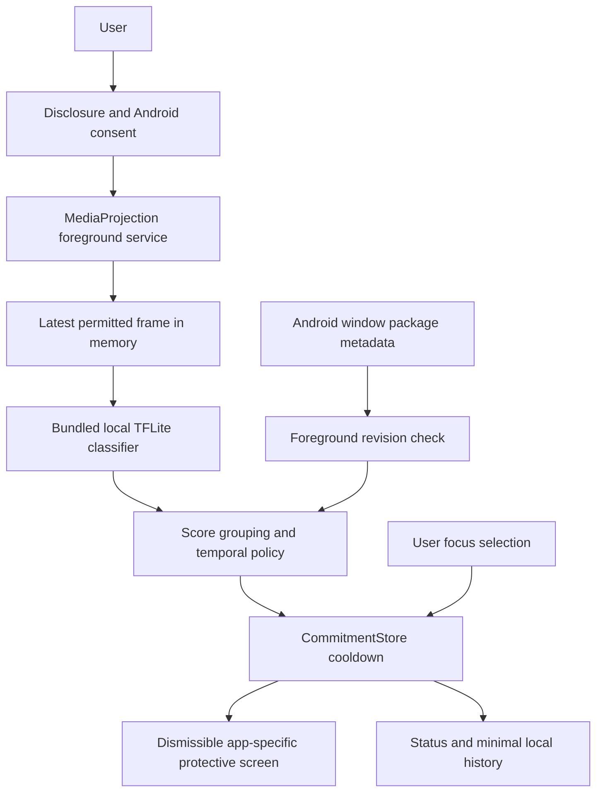

# Runtime architecture

Veil keeps the existing native Kotlin/Compose/Material3, Hilt and Room foundation. A focused reconstruction adds live systems instead of replacing healthy recovery, localization and persistence code. Versions and build commands are in the release document.

| Component | Responsibility |
| --- | --- |
| MainActivity / VeilDashboard | Consent, onboarding, navigation, real service status, app selection, recovery/history/privacy |
| CommitmentStore | App-private rules and capped minimal history; StateFlow snapshots; monotonic deadlines and boot identity |
| SessionDeadline | Pure monotonic expiry policy, host unit-tested |
| VeilAccessibilityService | Foreground window package metadata, reversible app-specific overlays; no content retrieval or gestures |
| VeilMonitoringService | One explicit consent per capture session, latest frame reader, worker-thread local inference and cleanup |
| MonitoringRuntime | Ephemeral running/health state and foreground observation revision; no frames/history |
| TensorFlowLiteInitializer / ScreenClassifier | Code-pinned asset integrity, tensor/label checks, actual five-class offline inference |
| TemporalDetectionEvaluator | Two confirming scores in a rolling three-frame window; resets on transitions/errors/stale frames |
| Existing Room repository / recovery UI | Persisted notes and legacy recovery preferences with existing migrations |

The current UI observes StateFlow with lifecycle-aware collection. Capture owns its native resources on one worker thread. Android's system projection notification and Veil's foreground notification expose capture. DataStore is not added because the existing app already has Room and the small atomic commitment snapshot uses private SharedPreferences; two persistent stores are explicitly separate and deletion controls name their scope.

Focus remains available without screen sharing. Accessibility disconnection stops capture and removes interventions; a saved commitment alone never implies working enforcement. An active projection alone does not imply analysis on protected, system or unobservable screens. Reboot safely ends deadlines and never resumes screen sharing. A display configuration change terminates the session and requests new consent instead of risking token reuse.

Old ProtectionEngine remains used by the retained manual recovery UI; live app rules use CommitmentStore. No fake statistics, remote backend, autonomous gestures or capture-token persistence is added. Architectural consolidation can follow once physical qualification establishes correct behavior.
